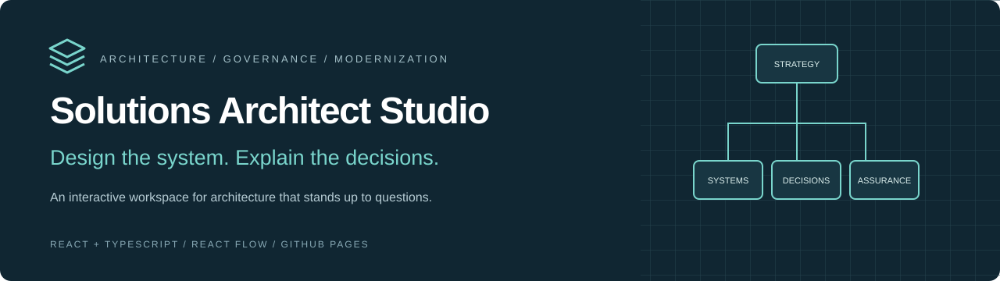
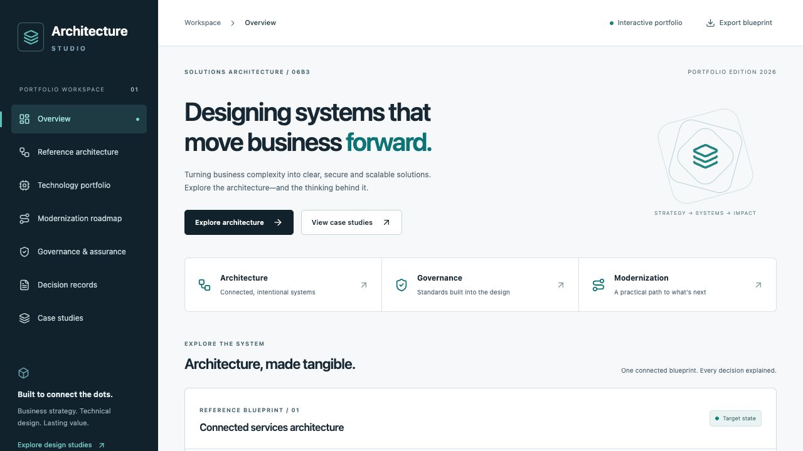
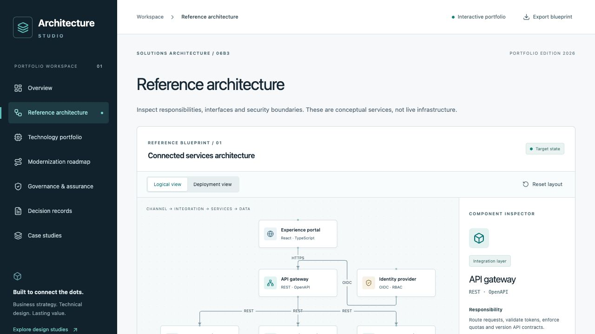
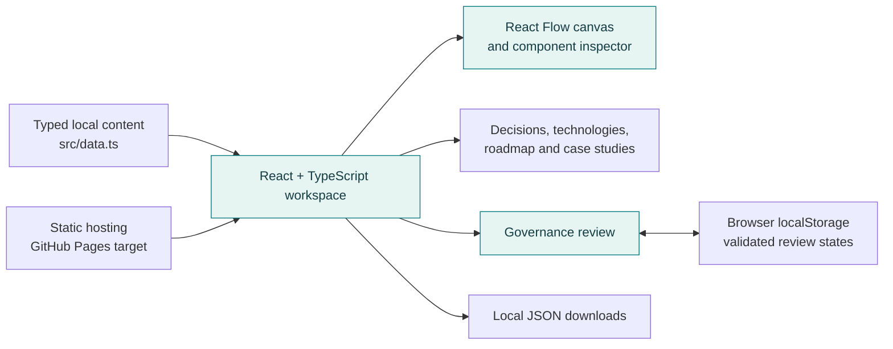
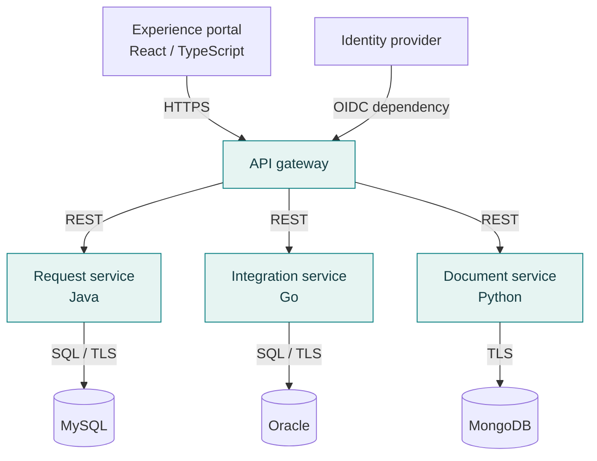
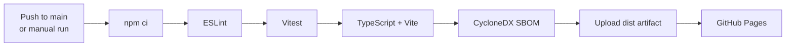

<div align="center">



# Solutions Architect Studio

**Explore the system. Challenge the trade-offs. Follow the path to modernization.**

An interactive enterprise architecture portfolio that makes technical decisions visible—through navigable system diagrams, decision records, technology evaluations and governance reviews.

[](package.json)
[](tsconfig.json)
[](vite.config.ts)
[](src/style.css)
[](LICENSE)

[**Quick start**](#quick-start) · [**Explore the workspace**](#explore-the-workspace) · [**Architecture**](#architecture) · [**Engineering highlights**](#for-recruiters-and-engineers) · [**Contribute**](#contributing)

</div>



> **A working frontend. A documented architectural point of view.** The website runs locally without API keys, a backend or a database. The enterprise services shown inside it are illustrative designs—not running infrastructure or claims of client delivery.

## Why this project exists

A diagram can show what connects. A useful architecture also explains **why those connections exist**, **what can fail**, **who owns the data**, and **how the design evolves**.

Solutions Architect Studio brings those questions into one explorable workspace. Select an API gateway and inspect its security responsibilities. Read the decision behind a persistence choice. Follow a modernization initiative to its dependencies and exit criteria. Review the design against twelve assurance controls.

It is built for engineers who want to inspect the implementation, architects who want to discuss trade-offs, and hiring teams who want concrete evidence of systems thinking.

## Explore the workspace

| Workspace | What you can actually do | Architectural question it answers |
| :--- | :--- | :--- |
| **🧭 Reference architecture** | Pan, zoom, drag nodes, fit/reset the canvas, switch logical/deployment views and inspect components. | How do the parts connect—and where are the responsibilities? |
| **📝 Decision records** | Search and filter three expandable ADRs with context, alternatives, consequences and operational considerations. | Why choose this approach over another? |
| **🧰 Technology portfolio** | Search fourteen entries and filter by category; compare roles, strengths and trade-offs. | Which tool fits the problem and its constraints? |
| **🛤️ Modernization roadmap** | Filter six initiatives by phase, priority and domain; inspect dependencies, risks and success measures. | What should change first, and how will progress be judged? |
| **🛡️ Governance & assurance** | Review twelve controls, update four-state assessments, persist them locally and export JSON. | What evidence is still needed before acceptance? |
| **📚 Case studies** | Expand three design studies covering modernization, integration and data governance. | How does a business problem become a technical proposal? |

The overview ties these areas together. **Export blueprint** downloads the component, ADR and initiative data as JSON.

### Inside the architecture canvas



**Try this two-minute walkthrough:**

1. Open **Reference architecture** and select **API gateway**. Read its responsibility, interfaces, security considerations and trade-off.
2. Switch to **Deployment view** to reveal cloud platform, delivery pipeline and observability components.
3. Open **Decision records**, search `storage`, and expand **ADR-002** to compare persistence alternatives.
4. Open **Modernization roadmap** and select **Modernize → High → Integration** to isolate the API-boundary initiative.
5. In **Governance & assurance**, set a control to **In Review**, reload the page, and export your assessment.

Diagram information is also available through the expandable **Accessible component list**. Local governance storage is browser-specific; exported files preserve a portable copy.

## Architecture

### The application you are running



No server-side application is required. Navigation uses URL hashes, structured examples live in the source, and JSON downloads are generated in the browser.

### The enterprise system being modeled



This diagram summarizes the app's logical blueprint. Java, Go, Python, Oracle, MySQL, MongoDB and OIDC are **modeled technologies**, not implemented backend integrations. The deployment-oriented view adds representative platform dependencies; it does not provision cloud resources.

Read the [architecture documentation and capability mapping](docs/architecture.md) for ownership assumptions, boundaries and proposed validation criteria.

### Engineering decisions worth inspecting

| Decision | Reason | Trade-off |
| :--- | :--- | :--- |
| **Local typed content** | Keeps the showcase reproducible and independent of external services. | Content updates require a source change and rebuild. |
| **Hash navigation** | Supports section links on static hosting without server rewrites. | URLs use fragments rather than path-based routes. |
| **React Flow + a component list** | Supports spatial exploration while preserving another path to component information. | The layout and connections are authored in code; this is not a general-purpose diagram editor. |
| **Versioned localStorage key** | Retains review progress with validation of recognized controls and statuses. | No cross-device sync, shared review history or multi-user collaboration. |
| **Native disclosure and select controls** | Keeps common interactions understandable and dependency-light. | Custom interaction patterns are intentionally limited. |
| **Build gates before deployment** | The workflow orders lint, tests and compilation before publishing. | A configured workflow is not proof of a successful hosted run. |

## Technology stack

| Area | Implemented tools | Where to inspect |
| :--- | :--- | :--- |
| Interface | React 19, TypeScript with strict checking | [Application shell](src/main.tsx), [TypeScript config](tsconfig.json) |
| Diagramming | `@xyflow/react` / React Flow | [Architecture canvas](src/Architecture.tsx) |
| Styling | Tailwind CSS 4 integration, custom CSS design system, Lucide icons | [Styles](src/style.css) |
| Build | Vite 7, npm lockfile | [Vite config](vite.config.ts), [Dependencies](package.json) |
| Tests | Vitest, React Testing Library, user-event, jsdom | [Behavioral tests](src/Workspace.test.tsx) |
| Code quality | ESLint, typescript-eslint, Prettier | [ESLint config](eslint.config.js) |
| Delivery | GitHub Actions, GitHub Pages, npm-generated CycloneDX SBOM | [Deployment workflow](.github/workflows/deploy.yml) |

## Quick start

### 1. Get the source

**Prerequisites:** Git, npm and **Node.js 22.13 or newer**. The deployment workflow uses Node 22; a recent Node 22 release keeps local development aligned with CI.

```bash
git clone https://github.com/skeeb32/solutions-architect-studio.git
cd solutions-architect-studio
```

### 2. Install and run

```bash
npm ci
npm run dev
```

Open the URL Vite prints in your terminal—normally `http://127.0.0.1:5173/`.

**Configuration:** no `.env` file, API credentials, database setup or paid service is needed. `npm ci` installs the versions recorded in `package-lock.json`.

### 3. Verify your changes

```bash
npm run lint
npm run test -- --run
npm run build
```

The build performs TypeScript checking before Vite bundles the site. Tests run once and exit, making the command suitable for CI.

### 4. Preview the production build

```bash
npm run preview
```

Open the preview URL printed by Vite. Run `npm run build` again after changing source files; preview serves the existing `dist/` output.

<details>
<summary><strong>Command reference and common fixes</strong></summary>

| Command | Purpose |
| :--- | :--- |
| `npm run dev` | Start the development server on loopback. |
| `npm run lint` | Check source with ESLint. |
| `npm run test -- --run` | Execute the behavioral test suite. |
| `npm run build` | Check types and create the production bundle in `dist/`. |
| `npm run preview` | Serve the production bundle locally. |
| `npm run format` | Format source and configured project files with Prettier. |
| `npm audit` | Review current dependency advisories; results can change over time. |

- **Install fails:** check `node --version`, use a supported Node version, and confirm the lockfile matches `package.json`.
- **Port already in use:** use the actual URL printed by Vite; it can choose another port.
- **Blank Pages deployment:** confirm the repository name matches the base path in `vite.config.ts`.
- **Review did not persist:** browser storage can be unavailable or cleared; use **Export review** to retain a copy.

</details>

## Deploy to GitHub Pages

The repository includes a workflow triggered by pushes to **`main`** or a manual run:



1. Open the repository's **Settings → Pages**.
2. Select **GitHub Actions** as the build and deployment source.
3. Push to `main`, or run **Deploy Solutions Architect Studio** from the **Actions** tab.
4. Confirm both jobs succeed, then open the URL reported by the deployment step.

The build job has read-only repository permissions. The deploy job receives `pages: write` and `id-token: write`. A concurrency group prevents overlapping Pages deployments. The generated dependency inventory is included at `dist/sbom.cdx.json`; generation does not itself scan or certify dependencies.

**Base path:** CI builds use `/solutions-architect-studio/`. If you rename your fork, change `vite.config.ts`. A user-site repository or custom domain typically needs `/`. No hosted demo is claimed here until a deployment succeeds.

## Project evidence

These are inspectable project facts—not adoption estimates or production benchmarks.

| Measure | Current source | Evidence |
| :--- | :--- | :--- |
| Navigable workspace sections | **7** | [Navigation entries](src/main.tsx) |
| Architecture components | **12**; logical view shows 9 | [Component data](src/data.ts), [view logic](src/Architecture.tsx) |
| Decision records | **3** | [ADR content](src/data.ts) |
| Technology entries | **14** | [Technology data](src/data.ts) |
| Modernization initiatives | **6** across 3 phases | [Initiative data](src/data.ts) |
| Governance controls | **12** with 4 available statuses | [Review implementation](src/Workspace.tsx) |
| Illustrative case studies | **3** | [Case study content](src/data.ts) |
| Automated behavioral tests | **5** | [Test suite](src/Workspace.test.tsx) |
| Package version | **1.0.0** | [Package manifest](package.json); not a tagged-release claim |

**Validation snapshot — October 26, 2026:** all five behavioral tests passed locally. The tests cover combined decision filters and empty results, technology categories, intersecting roadmap filters, review persistence across remounts, and malformed/unrecognized storage data.

**Coverage is not measured or published.** Browser automation, full accessibility auditing, performance benchmarks and every responsive breakpoint are not covered by this five-test suite. No fabricated coverage badge, uptime figure or performance score is displayed.

### Live repository activity

[](https://github.com/skeeb32/solutions-architect-studio/stargazers)
[](https://github.com/skeeb32/solutions-architect-studio/forks)
[](https://github.com/skeeb32/solutions-architect-studio/commits/main/)
[](https://github.com/skeeb32/solutions-architect-studio/actions/workflows/deploy.yml)

These badges read live repository data; they do not imply a minimum activity level or a passing deployment. See [contributors](https://github.com/skeeb32/solutions-architect-studio/graphs/contributors) for contribution history and [Actions](https://github.com/skeeb32/solutions-architect-studio/actions) for the actual run results.

## For recruiters and engineers

**Start with the canvas, read ADR-002, then inspect the governance persistence code.** That path connects interface engineering, architectural judgment and defensive implementation in a few minutes.

| Capability | Concrete evidence to review |
| :--- | :--- |
| **Frontend engineering** | Typed React components, custom diagram nodes, controlled filters, responsive CSS and hash-based navigation. |
| **Systems thinking** | Explicit service responsibilities, domain-owned persistence, integration boundaries and security trade-offs. |
| **Architecture communication** | Context-rich ADRs, stakeholder-readable case studies and capability-to-design traceability. |
| **Governance and lifecycle reasoning** | Assurance controls, modernization dependencies, retirement criteria and proposed recovery measures. |
| **Defensive state handling** | Recognition checks for saved controls/statuses, malformed JSON recovery and storage-failure messaging. |
| **Delivery discipline** | Lockfile-based installation, tests and type checks, scoped workflow permissions, Pages packaging and SBOM generation. |

The implemented engineering work is the TypeScript frontend and its delivery configuration. Enterprise backend examples demonstrate design reasoning; they do not establish experience operating those systems at production scale.

## Make it your own

```text
solutions-architect-studio/
├── .github/workflows/deploy.yml  # Verification, SBOM and Pages delivery
├── docs/
│   ├── architecture.md          # Boundaries and capability traceability
│   └── assets/                  # README banner and real screenshots
├── src/
│   ├── main.tsx                 # Application shell, navigation and overview
│   ├── Architecture.tsx         # Diagram nodes, connections and inspector
│   ├── Workspace.tsx            # Explorers, governance and exports
│   ├── Workspace.test.tsx       # Five behavioral tests
│   ├── data.ts                  # Illustrative content
│   └── style.css                # Responsive visual system
├── package.json
├── package-lock.json
├── tsconfig.json
├── vite.config.ts
└── LICENSE
```

- **Change the narrative:** edit the examples in `src/data.ts` and the overview in `src/main.tsx`.
- **Change the visual system:** adjust the tokens and component styles in `src/style.css`.
- **Extend the blueprint:** update component data, positions and connections in `src/Architecture.tsx`. Node placement is currently an explicit indexed array, so adding data alone is insufficient.
- **Use your own experience:** replace illustrative studies only with work and outcomes you can substantiate. Avoid confidential client or employer information.
- **Update screenshots:** keep `docs/assets/` aligned with the interface so the README remains an accurate preview.

## Roadmap

### Delivered

- [x] Interactive logical and deployment-oriented architecture views.
- [x] Component inspector and accessible component list.
- [x] Searchable ADRs and technology portfolio.
- [x] Multi-filter modernization roadmap.
- [x] Local governance review persistence and JSON exports.
- [x] Three illustrative case studies.
- [x] Behavioral tests and GitHub Pages workflow.

### Proposed next steps

These are contribution opportunities, not features currently shipping or promised delivery dates. No separate active implementation is claimed.

- [ ] Complete browser checks at 320, 768, 1024 and 1440 pixels.
- [ ] Add end-to-end coverage for diagram interaction, navigation and downloads.
- [ ] Run a full keyboard and screen-reader accessibility review.
- [ ] Add measured test coverage and publish a reproducible report.
- [ ] Replace indexed diagram positions with a layout model that supports additional blueprints.
- [ ] Add validated JSON import for portable governance reviews.

## Contributing

**A better explanation, a stronger test or a more usable interaction is a valuable contribution.**

1. Fork the repository and clone your fork.
2. Create a focused branch:

   ```bash
   git switch -c feat/describe-your-change
   npm ci
   npm run dev
   ```

3. Make the change. Keep sample architectures explicitly illustrative and explain new trade-offs.
4. Add or update behavioral tests when changing functionality, then run:

   ```bash
   npm run format
   npm run lint
   npm run test -- --run
   npm run build
   ```

5. Push your branch and open a pull request against `main`.

**A useful pull request includes:** the problem, resulting behavior, verification performed, screenshots for interface changes, and any known limitations. Never commit credentials, personal review data, `node_modules/` or build output.

For bug reports, include the affected section, reproduction steps, expected/actual behavior and browser version. For substantial changes, open an issue first to discuss scope and design. Contributions remain under the [MIT license](LICENSE).

## Scope and attribution

This independent educational portfolio was inspired by a supplied Solutions Architect / 06B3 competency brief. It is not an official government website and does not imply endorsement. The [referenced Chicago classification page](https://www.chicago.gov/city/en/depts/dhr/supp_info/administrative_services0600.html) returned HTTP 403 during initial implementation; exact alignment with its current text has not been independently verified.

Security controls are design considerations, review statuses are self-assessments, and recovery figures are proposed validation targets. No certification or measured production outcome is claimed.

Built with [React](https://react.dev/), [React Flow](https://reactflow.dev/), [Vite](https://vite.dev/), [Tailwind CSS](https://tailwindcss.com/) and [Lucide](https://lucide.dev/). See [LICENSE](LICENSE) for reuse terms.

---

<div align="center">

### Make architecture easier to explore—and harder to hand-wave.

**⭐ Star it if the approach is useful. Fork it to build your own studio.**

Try the workspace, share it with an engineer, or contribute the next well-reasoned improvement.

[Get started](#quick-start) · [Report an issue](https://github.com/skeeb32/solutions-architect-studio/issues) · [Open a pull request](https://github.com/skeeb32/solutions-architect-studio/pulls) · [Meet the author](https://github.com/skeeb32)

</div>
